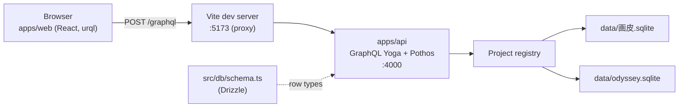
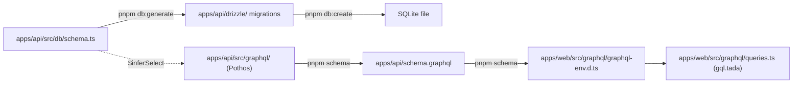
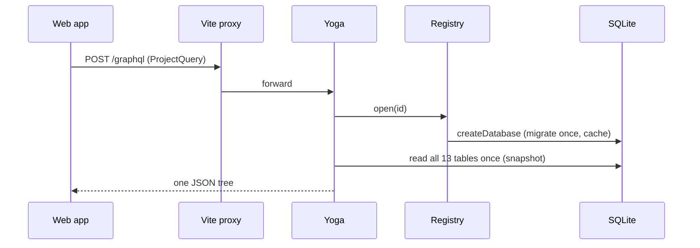

# Story Timeline

Story Timeline keeps the facts of a story (events, characters, relations, and who knows what and when) in SQLite, shows them as a timeline, and lets AI agents read and edit them through GraphQL.

> **Local use only.** The API has no authentication. Run it on your own machine and do not expose it to a network. See [SECURITY.md](SECURITY.md).

A pnpm workspace with two apps. The API stores story data in SQLite files with a Drizzle schema and serves it over GraphQL. The web app shows the story as a timeline and reads all data from the API.



See the [schema reference](docs/database.md) for the ERD, relationships, tables, and fields.

## Quick start

Use Node.js 22 or later and pnpm 11.5.1. Run all commands from the repository root.

```sh
pnpm install --frozen-lockfile
pnpm dev
```

Open http://localhost:5173 and pick a project in the project picker: `画皮` or `odyssey`.

`pnpm dev` starts both apps:

| App | URL | Purpose |
| --- | --- | --- |
| API | http://localhost:4000/graphql | GraphQL endpoint and GraphiQL |
| Web | http://localhost:5173 | Timeline app |

## Example projects

The repository ships two example projects. Both works are in the public domain. All text in the projects is a new summary; nothing is copied from a translation.

| Project | Work | Language | Size |
| --- | --- | --- | --- |
| `画皮` | 蒲松龄《聊斋志异·画皮》 | Chinese | 4 acts, 10 characters, 16 events |
| `odyssey` | Homer, *Odyssey* | English | 6 acts, 43 characters, 45 events |

画皮 is told in story order. The Odyssey is not: Books 9–12 are a flashback, and Book 19 stops to tell how Odysseus got his scar. Each event belongs to the act (a group of books) that tells it, and `sortOrder` is story time. So the timeline's act mode shows the order of the telling, and its time mode shows the order of the story. The events that tell a flashback have links of kind `reveal` (`flashback`, `digression`) to the events they tell.

The two files are in `apps/api/data`. Their seed data is in `apps/api/scripts/examples/`. `pnpm db:example --force` builds both files again from it. Without `--force`, the command stops when either file exists and changes nothing.

## Projects

One project is one SQLite file. The API reads the data folder and lists every `*.sqlite` file as a project. The project id is the file name without `.sqlite`.

| Setting | Default | Meaning |
| --- | --- | --- |
| `DATA_DIR` | `apps/api/data` | The folder the API serves |
| `PORT` | `4000` | The API port |
| `HOST` | `127.0.0.1` | The address the API listens on. The API has no auth, so keep it local. `0.0.0.0` listens on every interface |
| `API_URL` | `http://localhost:4000` | Where the Vite proxy sends `/graphql` |

The API accepts browser requests only from pages on `localhost`, `127.0.0.1`, or `[::1]`. A request with another `Origin` header gets 403, so a page on another site cannot send a mutation. A request whose `Host` header is not this machine or `HOST` also gets 403. curl and scripts send no `Origin` and work as before.

To add a project, create a database file in the data folder:

```sh
pnpm db:create data/my-novel.sqlite
```

The command creates the parent folder and applies the saved migrations. The API also applies pending migrations when it opens a project for the first time. Relative paths start at `apps/api`, because pnpm runs each script in its package folder.

To import a story-reviewer YAML project:

```sh
pnpm db:import /path/to/project/data data/<id>.sqlite
```

The command stops when the database file exists. Add `--force` to delete the file and import again: `pnpm db:import /path/to/project/data data/<id>.sqlite --force`. The importer prints a report of every field and file the schema did not capture.

Git ignores project databases in `apps/api/data`, so back up your own files. To track another example database, add a `!apps/api/data/<name>.sqlite` line to `.gitignore`. Git treats `*.sqlite` as binary, so a change shows as a whole-file update. SQLite journal and WAL files (`*.sqlite-*`) stay ignored.

## Read the API with an agent

Every type, field, and enum value in the API has a description. An agent can read the story model from the schema alone.

- Read [apps/api/schema.graphql](apps/api/schema.graphql), or send an introspection query to `http://localhost:4000/graphql`.
- Open `http://localhost:4000/graphql` in a browser for GraphiQL with a docs panel.

Step 1: list the projects.

```graphql
{ projects { id name } }
```

Step 2: read one project. The whole story fits in one query.

```graphql
{
  project(id: "odyssey") {
    acts { name position }
    characters { key name kind relations { otherKey relation mutual member sinceKey untilKey tone } }
    events { key title actName placeKey participants { characterKey presence exit } links { toKey relation } }
    learnings { key text characters { characterKey sinceKey untilKey } }
  }
}
```

Step 3: resolve every `*Key` and `actName` field against the matching list: `characters[].key`, `events[].key`, `places[].key`, `learnings[].key`, `sources[].key`, `acts[].name`.

[docs/agent-workflow.md](docs/agent-workflow.md) lists the agent flows. The first one, end to end story creation, reads a project this way and writes a story from it.

## Write the API with an agent

The `Mutation` type has one `upsertX` and one `deleteX` field per table. An upsert inserts a new row or patches an existing one: omitted fields keep their value, `null` clears a field. Nothing cascades on delete, so an agent deletes child rows before their parent. One document with several aliased fields writes a whole batch in order.

A key can be renamed. There is one `renameX` field per parent table: `renameAct(name, newName)`, and `renamePlace`, `renameCharacter`, `renameEvent`, `renameLearning`, `renameSource` with `key` and `newKey`. Every foreign key is `ON UPDATE CASCADE`, so every child row and reference moves to the new key in the same write. The rename fails with a clear error when the old key is not found or the new key exists. An upsert with a new key always inserts a new row; it never renames.

```graphql
mutation ($p: ID!) {
  renameCharacter(projectId: $p, key: "arthur", newKey: "king-arthur") { key relations { otherKey } }
}
```

The database also rejects a relation from a character to itself, a link from an event to itself, a place that is its own parent, and a second link with the same `eventKey`, `toKey`, and `relation`. The error names the rule, and `extensions.rule` holds its name. A link can store its kind (`cause`, `setup`, `reveal`, `echo`) in `kind`, and a relation can store its tone (`family`, `love`, `friend`, `work`, `hostile`, `other`) in `tone`; without them, the web app reads the `relation` word. A citation can store its order in `position`.

One document is one transaction, and the batch is all or nothing. A later field sees the rows of earlier fields. When one field fails, the server writes no field of the document, and `errors` names the failed field. The response field `extensions.transaction` is `committed` or `rolledBack`. One document writes one project.

```graphql
mutation ($p: ID!) {
  e: upsertEvent(projectId: $p, input: { key: "duel", actName: "act-3", sortOrder: 340, title: "The duel" }) { key }
  p: upsertEventCharacter(projectId: $p, eventKey: "duel", input: { characterKey: "arthur", presence: body }) { characterKey }
}
```

Flow 2 in [docs/agent-workflow.md](docs/agent-workflow.md) is the full editing workflow: introspect, read, draft rows, write one batch, check, fix.

## Schema contract

The database schema is the source of truth. The GraphQL types mirror its tables one to one. The web app gets its query types from the committed SDL file.





### Change the database schema

Edit `apps/api/src/db/schema.ts`, then generate and apply a migration:

```sh
pnpm db:generate
pnpm db:create
```

Review the generated SQL before applying it to a file with data. Commit the schema and the generated files in `apps/api/drizzle/` together. Update the [schema reference](docs/database.md) and [standalone ERD](docs/story-schema-erd.mmd) when the model changes.

### Change the GraphQL schema

Edit the files in `apps/api/src/graphql/`, then regenerate the contract:

```sh
pnpm schema
```

The command writes `apps/api/schema.graphql` and `apps/web/src/graphql/graphql-env.d.ts`. Commit both. A test fails when the committed SDL is out of date, or when a type, field, argument, or enum value has no description.

## Check the project

```sh
pnpm typecheck
pnpm test
```

These commands run in every workspace package. The API tests create temporary SQLite files and run GraphQL queries against them. The web tests use a fixture with the same story as the API test seed. A test builds both example projects in a temporary folder and checks them through GraphQL.

## Files

| Path | Purpose |
| --- | --- |
| `package.json` | Workspace root. Scripts forward to the packages. |
| `pnpm-workspace.yaml` | Lists `apps/*` and `packages/*` as workspace packages. |
| `apps/api/src/db/schema.ts` | Drizzle definitions for all 13 story tables. |
| `apps/api/src/db/client.ts` | Open a local file, enable foreign keys, and apply migrations. |
| `apps/api/src/projects/registry.ts` | Find `*.sqlite` files in the data folder and cache connections. |
| `apps/api/src/projects/snapshot.ts` | Read every table of one project once per request. |
| `apps/api/src/graphql/` | Pothos types, enums, inputs, the `Mutation` type, descriptions, and the Yoga app. |
| `apps/api/src/projects/write.ts` | Upsert and delete one row of any table, and rename a parent key; turns SQLite constraint errors into GraphQL errors that name the rule. |
| `apps/api/src/server.ts` | HTTP server entry point. |
| `apps/api/schema.graphql` | The committed GraphQL SDL with descriptions. |
| `apps/api/scripts/create-db.ts` | Database creation command. |
| `apps/api/scripts/seed-example.ts` | Builds the example projects `data/画皮.sqlite` and `data/odyssey.sqlite`. |
| `apps/api/scripts/examples/` | Seed data of the example projects, and the checks for the rules the database does not enforce. |
| `apps/api/scripts/import-yaml.ts` | Imports a story-reviewer YAML project and reports the gaps. |
| `apps/api/scripts/export-schema.ts` | Writes `schema.graphql`. |
| `apps/api/drizzle/` | Generated SQL migrations and their saved state. |
| `docs/database.md` | Schema reference with an embedded ERD. |
| `docs/agent-workflow.md` | Agent flows against the GraphQL API. |
| `apps/api/tests/` | Database, GraphQL, mutation, and schema tests. |
| `apps/api/data/` | The project database files. Git tracks only the example databases. |
| `apps/web/src/graphql/` | urql client, typed queries, generated introspection types. |
| `apps/web/src/data/assemble.ts` | Turns a GraphQL result into the app's view model. |
| `apps/web/src/timeline/build.ts` | Derives lanes, sections, and filters from the view model. |
| `apps/web/src/components/` | Timeline, sidebar, detail panel, and shadcn UI. |

Git ignores `node_modules/`, `apps/web/dist/`, `.DS_Store`, `.claude/`, project databases other than the examples, and SQLite journal files. The schema uses Drizzle ORM `0.45.4` and Drizzle Kit `0.31.11`.

## Contributing

See [CONTRIBUTING.md](CONTRIBUTING.md). Report security problems as described in [SECURITY.md](SECURITY.md).

## License

Copyright (C) 2026 Daiwei Lu. Story Timeline is licensed under the [GNU Affero General Public License v3.0 only](LICENSE) (AGPL-3.0-only).

- Individuals and companies may use it freely, including for internal use.
- If you offer a modified version as a network service, you must publish its source code under the same license.
- If your company uses Story Timeline, please add it to [ADOPTERS.md](ADOPTERS.md). This is a kind request, not a requirement.
