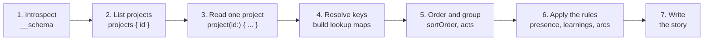
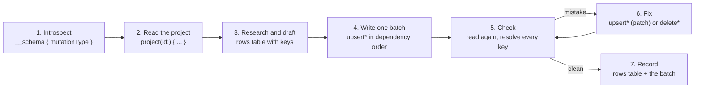
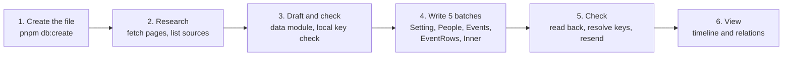

# Agent flows

This page collects the flows an AI agent can run against the GraphQL API. Each flow is a numbered list of steps with the exact queries. An agent needs only the HTTP endpoint; it does not read the repository.

| Flow | Goal | Status |
| --- | --- | --- |
| [End to end story creation](#flow-1-end-to-end-story-creation) | Read one project and write a complete story from it | Ready, with the example projects `画皮` and `odyssey` |
| [Add or edit story data](#flow-2-add-or-edit-story-data) | Research a topic and write the rows through mutations only | Done, on a research project |
| [Build a project from research](#flow-4-build-a-project-from-research) | Create an empty project and fill every table from one study of a work | Done, on a research project |
| [Take a brief from the web app](#flow-5-take-a-brief-from-the-web-app) | Copy a short Markdown brief of a character, an event, or the story, and write from it | Done, on a research project |

More flows will be added here. Keep each flow self-contained: prerequisites, steps, queries, rules, and the result.

## Common prerequisites

Start the API. The example projects `画皮` and `odyssey` are in the repository. To build them again from their seed, run `pnpm db:example --force` first.

```sh
pnpm dev
```

The endpoint is `http://localhost:4000/graphql`. Every request is an HTTP POST with a JSON body `{ "query": "...", "variables": { ... } }`. GraphiQL at the same URL shows every description.

---

## Flow 1: End to end story creation

Goal: read one project and write a complete story that follows its events, characters, and rules. The examples below use the `画皮` project. The `odyssey` project shows how to handle a work that is told out of order.



### Step 1: introspect the schema

The agent does not know the model. It asks the API for every type, field, and description:

```graphql
{
  __schema {
    queryType { name description fields { name description args { name description } } }
    types {
      kind name description
      fields { name description type { kind name ofType { kind name ofType { kind name } } } }
      enumValues { name description }
    }
  }
}
```

The `Query` description gives the three-step reading plan. Each type description names its module and primary key. Each field description says what the value is and which list resolves it. The enum descriptions explain `presence`, `exit`, and `kind`.

What the agent learned here:

- References are keys, not nested objects. `otherKey`, `toKey`, `placeKey`, `sinceKey`, `untilKey`, and `actName` must be resolved on the client.
- `relations` and `links` are outgoing only. A `mutual` row counts in both directions.
- A learning interval with `sinceKey: null` is known from the story start.

### Step 2: list the projects

```graphql
{ projects { id name } }
```

Result: `odyssey` and `画皮`, and any project of your own. The agent chooses `画皮`.

### Step 3: read the whole project in one query

```graphql
query Story($id: ID!) {
  project(id: $id) {
    id name
    acts { name position span description }
    places { key name realm parentKey description }
    characters {
      key name kind category description
      names { name note }
      relations { otherKey relation mutual member sinceKey untilKey tone }
      arcStages { position stage time sinceKey description }
    }
    events {
      key title sortOrder actName time placeKey isCore confidence description
      participants { characterKey presence exit }
      links { toKey relation mutual note }
      sources { sourceKey ref }
    }
    learnings { key kind text characters { characterKey sinceKey untilKey time note } }
    sources { key title location note }
  }
}
```

Variables: `{ "id": "画皮" }`. One round trip returns 4 acts, 9 places, 10 characters, 16 events, 7 learnings, and 2 sources.

### Step 4: resolve the keys

The agent built four maps and replaced every key with its display value:

| Map | From | Used by |
| --- | --- | --- |
| character name | `characters[].key` | `participants`, `relations.otherKey`, `learnings.characters` |
| place name | `places[].key` | `events.placeKey`, `places.parentKey` |
| event title | `events[].key` | `links.toKey`, `sinceKey`, `untilKey` |
| act | `acts[].name` | `events.actName` |

A short script prints one readable digest: acts, places, characters with relations and arc stages, events in order with participants and links, learnings with who knows them and when.

### Step 5: order and group

- Sort `events` by `sortOrder`. This is story time: the order in which things happen.
- Group events by `actName`, in `acts[].position` order. An act is a plot unit. In `画皮` the four acts follow the tale, so both orders agree.
- In `odyssey` the orders differ. Each event is in the act (a group of books) that tells it. The wanderings (`cicones` to `shipwreck`) have `sortOrder` 30 to 130, but they sit in the act `Books 9–12`, after the Telemachy. The event `tale-told` has a `flashback` link to each of them. In the same way, `scar` has a `digression` link (kind `reveal`) to `boar-hunt`, the earliest event of the story.
- Choose one order for the story. Follow the acts to keep the original telling. Follow `sortOrder` to tell it straight. `time` gives the readable time of each scene.

### Step 6: apply the data rules while writing

The data constrains the text. The agent checks each scene against these fields:

| Field | Rule, with examples from `画皮` and `odyssey` |
| --- | --- |
| `participants.presence` | `body` characters act and speak. `mentioned` characters are only spoken about (狞鬼 in 陈氏劝遣). `mind` puts the scene in a character's head (Penelope in `penelope-dream`). `spirit` is a ghost (Tiresias in `underworld`). `related` characters are affected but absent (陈氏 in 二郎报信). |
| `participants.exit` | `dies` ends a character (狞鬼 in 木剑斩鬼). `leaves` takes a character out of the story (道士 in 陈氏求救). The schema has no revival, so 王生's death in 碎拂掏心 is a `leaves`, and he is back in `body` at 王生复活. |
| `isCore` | Core events get full scenes. Other events stay short. |
| `confidence` | `likely`: the place of 二郎报信 is inferred. `unsure`: the story time of `hermes-calypso` is debated. Write such details so they do not depend on the guess. |
| `links` | `导致` and `leads to` chains set cause and effect. `伏笔` plants the meeting at 青帝庙. `揭示` shows that the spittle was the heart. `呼应` ties the painting of the skin to its rolling up. |
| `learnings.characters` | A character may only use a fact after its `sinceKey` event. 狞鬼 knows the truth from the start (`sinceKey: null`). 王生 learns it at 窗窥画皮, and his `idea` that the woman is a runaway concubine ends there (`untilKey`). In `odyssey`, the order in which people learn `beggar-is-odysseus` is the plot of Books 13–24. |
| `relations` with `sinceKey` / `untilKey` | 道士 pities 狞鬼 from 野外求救 until 二郎报信; after that he is its enemy. |
| `arcStages` | Each stage starts at its `sinceKey` event: 王生 goes from 迷色 to 惊惧, 死去, and 复生. The narration changes with the stage. |
| `names` | 狞鬼 appears as 女郎 and later as 妪. Odysseus tells the Cyclops his name is Nobody. |
| `places.realm` | `penelope-dream` is a `dream` place, and `underworld` is a `spirit` place. Every place in `画皮` is physical. |
| `sources` | Each event cites the work by section. A second citation (`position` 2) adds the author's comment in `画皮` or the Butler translation in `odyssey`. |

### Step 7: write

Write one section per event, in the order chosen in step 5, grouped by act. Keep every fact inside the data: no character acts before their first event, and nobody uses a fact before they learn it.

### Repeat for another project

Change the `id` variable in step 3. Nothing else changes, because the schema is the same for every project.

---

## Flow 2: Add or edit story data

Goal: research one topic and write the result into a project through GraphQL mutations only. No SQL, no scripts, no file edits. The examples below use a project with the id `my-story`, a hero `hero`, a mentor `mentor`, and a few events. Replace them with the keys of your project.



### Step 1: introspect the mutations

```graphql
{
  __schema {
    mutationType {
      description
      fields { name description args { name description type { name ofType { name } } } }
    }
    types { kind name description inputFields { name description type { name ofType { name } } } }
  }
}
```

The `Mutation` description gives the editing plan. There is one `upsert*` and one `delete*` field per table, 26 in all, plus one `rename*` field per parent table (acts, places, characters, events, learnings, sources), 32 in all. Each `*Input` type mirrors the matching output type and names its primary key.

What the agent learned here:

- `upsert*` inserts when the primary key is new and otherwise patches: an omitted field keeps its value, `null` clears it. A batch can be sent twice without harm.
- Rows that have `position` in their primary key (relations, links, arc stages, learning intervals) can omit `position` to append after the last row of the parent.
- Nothing cascades on delete. A `delete*` that would orphan children fails, and the error names the foreign key.
- A key change cascades. `rename*` changes one primary key, and every reference to it follows in the same write.
- The database rejects a relation from a character to itself, a link from an event to itself, a place that is its own parent, and a second link with the same `eventKey`, `toKey`, and `relation`. The error names the rule; `extensions.rule` holds the name.
- One mutation document is one transaction. GraphQL runs the fields one after the other, in document order, so the document order is the dependency order. A later field sees the rows of earlier fields.
- A batch is all or nothing. When one field fails, the server writes no field of the document. `errors` names the failed field. `extensions.transaction` is `committed` or `rolledBack`.
- One document writes one project. A document that writes a second project fails with `MULTIPLE_PROJECTS`.

### Step 2: read the project

Run the Flow 1 step 3 query with `{ "id": "my-story" }` and build the key maps. Every key in a mutation must come from these lists; an unknown key is rejected by the database.

| Map | From | Needed for |
| --- | --- | --- |
| act names | `acts[].name` | `EventInput.actName` |
| place keys | `places[].key` | `EventInput.placeKey` |
| character keys | `characters[].key` | participants, relations, arc stages |
| event keys with `sortOrder` | `events[].key` | links, `sinceKey`, and the free `sortOrder` slots |
| source keys | `sources[].key` | citations |

Note what the read shows about the topic: the events that already have the character, empty descriptions, missing arc stages, and events where the sources put the character but the project does not.

### Step 3: research and draft the rows

Research stays inside the project's own sources when it can: `sources[]` lists them, and `location` points at the raw text. New facts cite an existing `sourceKey` with a `ref`. A fact taken from a fan summary rather than a reference page gets `confidence: likely`.

Draft every row as a table before writing anything. The `sortOrder` of a new event is a free integer between its two neighbours.

| key | sortOrder | between | place | participants | links |
| --- | --- | --- | --- | --- | --- |
| `mentor-youth` | 0 | start, `arrival` | old-town | mentor | 伏笔 → `mentor-stays` |
| `mentor-gives-map` | 52 | `storm`, `departure` | harbour | mentor, hero | 伏笔 → `map-used` |
| `mentor-falls` | 369 | `siege`, `retreat` | camp | mentor, hero, rival (related) | 导致 → `retreat` |

Plus: a description on the `mentor` row, a full name, and the arc stages with their `sinceKey` events.

### Step 4: write one batch

One document, aliased fields, parents before children. This is the shape of a batch with one example per kind.

```graphql
mutation MentorEvents($p: ID!) {
  # characters and their names first
  mentor: upsertCharacter(projectId: $p, input: { key: "mentor", description: "The hero's teacher, an old traveller." }) { key description }
  mentorFullName: upsertCharacterName(projectId: $p, characterKey: "mentor", input: { name: "Aren Vale", position: 2, note: "full name" }) { name }

  # then events
  e3: upsertEvent(projectId: $p, input: {
    key: "mentor-falls", sortOrder: 369, actName: "act-3", placeKey: "camp"
    title: "The mentor falls"
    description: "During the siege the mentor covers the retreat and is hurt."
  }) { key sortOrder }

  # then rows that point at events
  p3a: upsertEventCharacter(projectId: $p, eventKey: "mentor-falls", input: { characterKey: "mentor", position: 1, presence: body }) { characterKey }
  pDuel: upsertEventCharacter(projectId: $p, eventKey: "duel", input: { characterKey: "mentor", position: 10, presence: body }) { characterKey }
  l3: upsertEventLink(projectId: $p, eventKey: "mentor-falls", input: { toKey: "retreat", relation: "导致" }) { position toKey }
  s3: upsertEventSource(projectId: $p, eventKey: "mentor-falls", input: { sourceKey: "notes", ref: "ch. 12" }) { sourceKey }
  a3: upsertArcStage(projectId: $p, characterKey: "mentor", input: { position: 3, stage: "Peacemaker", sinceKey: "mentor-falls" }) { position stage }
}
```

Variables: `{ "p": "my-story" }`. Send it as one HTTP POST. The response holds one object per alias, read back from the database after the write, so the agent sees the stored row, not the input.

The batch is all or nothing. If `errors` is not empty, the database did not change, `data` is null, and `extensions.transaction` is `rolledBack`. Fix the failed field and send the whole batch again.

### Step 5: check

Read the project again with the Flow 1 query and check, in the client:

- every new key is in `events[]`;
- every `actName`, `placeKey`, `characterKey`, `toKey`, `sinceKey`, `untilKey`, and `sourceKey` resolves against its list;
- each new event sits between the neighbours chosen in step 3 (`Project.events` is already sorted by `sortOrder`).

### Step 6: fix

A wrong value is fixed with the same `upsert*` field; only the given fields change:

```graphql
mutation ($p: ID!) {
  upsertEvent(projectId: $p, input: { key: "mentor-falls", sortOrder: 371 }) { key sortOrder }
}
```

A wrong row is removed, children first:

```graphql
mutation ($p: ID!) {
  a: deleteEventSource(projectId: $p, eventKey: "tavern-brawl", sourceKey: "notes")
  b: deleteEventCharacter(projectId: $p, eventKey: "tavern-brawl", characterKey: "rival")
  c: deleteEventCharacter(projectId: $p, eventKey: "tavern-brawl", characterKey: "mentor")
  d: deleteEvent(projectId: $p, key: "tavern-brawl")
}
```

Deleting the event first would fail with `FOREIGN KEY constraint failed`.

A wrong key is renamed, not deleted and written again. Use the matching `rename*` field. Every row that refers to the key follows: participants, links at both ends, citations, and every `sinceKey` and `untilKey`. Rename before the fields that use the new key, in the same document:

```graphql
mutation ($p: ID!) {
  e: renameEvent(projectId: $p, key: "mentor-falls", newKey: "mentor-wounded") { key links { toKey } }
  l: upsertEventLink(projectId: $p, eventKey: "mentor-wounded", input: { position: 1, note: "Both sides stop after the attack" }) { position }
}
```

The rename fails when the old key is not found (`NOT_FOUND`) or the new key is taken (`KEY_EXISTS`). Then nothing in the document is written. Acts use `renameAct(name:, newName:)`.

A link whose word does not show its kind gets an explicit `kind`: `cause`, `setup`, `reveal`, or `echo`. The web app then uses the kind and ignores the word for the drawing and the briefs. `kind: null` clears it, and the word decides again:

```graphql
mutation ($p: ID!) {
  upsertEventLink(projectId: $p, eventKey: "storm", input: { position: 1, kind: setup }) { position relation kind }
}
```

A relation whose word does not show its tone gets an explicit `tone`: `family`, `love`, `friend`, `work`, `hostile`, or `other`. Set it when the word is a name, a role the web app does not know (`驾驶员`, `监护人`), or a word in another language. Use `other` when the relation has none of the named tones; it stops the guess. Leave `tone` empty on a member relation: the graph draws membership as a faction and ignores its tone. The web app then uses the tone for the graph colour, the tone filter, and the badge. `tone: null` clears it, and the word decides again:

```graphql
mutation ($p: ID!) {
  upsertCharacterRelation(projectId: $p, characterKey: "mentor", input: { position: 2, tone: work }) { position relation tone }
}
```

The order of an event's citations is `EventSourceInput.position`. `Event.sources` returns them by position, with unnumbered ones last.

### Step 7: record

The rows table from step 3 and the batch from step 4 are the record of the edit. The changed `*.sqlite` file in `apps/api/data` is the deliverable.

### Rules

| Rule | Why |
| --- | --- |
| Read before you write; use only keys from the lists | Foreign keys reject unknown keys, and a near-miss key (`wolf` versus `wolf-pack`) silently points at the wrong row |
| Parents before children, in one document | Fields run in order; a child written before its parent fails |
| After an error, resend the whole batch | A failed batch writes nothing, so a partial resend loses the rows of the fields that came before the error |
| Patch, do not replace | Omitted fields keep their value, so an edit never erases what another author wrote |
| `null` only to clear | `null` is a write, not an omission |
| Give `position` explicitly when the batch may run twice | An omitted `position` appends a new row on every send; a batch with every key given is idempotent |
| Add missing entities before the events that need them | A character or place that the sources name but the project lacks is an `upsertCharacter` or `upsertPlace` at the top of the same batch, not a key to improvise |
| Delete children first | Nothing cascades on delete |
| Rename a key with `rename*`, never by delete and insert | The rename moves every reference in one write; a new key in an upsert makes a second row |
| Set `kind` on a link when the word is not a known link word | The web app reads the kind first; without it, an unknown word counts as `other` |
| Set `tone` on a relation when the word is not a known relation word | The web app reads the tone first; without it, an unknown word counts as other (其他) in the graph |
| Cite an existing `sourceKey`; add a source row first when the work is new | `event_sources.source_key` is a foreign key |
| `confidence: likely` for facts from summaries | The reader can tell a reference page from a fan summary |
| Keep facts from other versions of a work out of the project | The acts follow one version, for example the book and not the film |

### Techniques

- **Backstory before the first event.** When `sortOrder` 0 and 1 are taken, backstory events can take -3, -2, -1. Negative values sort first; `time` carries the readable era.
- **Renumbering by patch.** When two events are adjacent and a new event must go between them, one `upsertEvent` with only `key` and `sortOrder` moves one of them. Its links and participants follow the key, so nothing else changes.

### Known gaps

| Gap | Workaround | Possible fix |
| --- | --- | --- |
| Appended rows are not idempotent | Give every `position` after reading the existing rows | Partly fixed for links: a unique index on (`eventKey`, `toKey`, `relation`) refuses the copy, so a resend fails and rolls back instead of adding a row. Relations and the other child tables still append |
| Participants and names need hand-numbered positions | Read first, then number | Allow `position` omission to append for all child tables |
| Entities the sources name are missing from the project | Add the rows at the top of the batch, or use an existing group | A pre-write step that lists named entities without a row |
| `sortOrder` slots run out | Pick the free integers, or renumber by patch | Space new events by 10 or 100 |
| No append to a text field | Read the old text, then send the full new text | None needed |
| No server-side check | The "every key resolves" check is a client script | A `Project.problems` query field that lists unresolved keys, duplicate positions, and events without participants |
| Imported participants have no `presence` | None | A one-time patch batch, or accept the mix |
| Unnamed roles have no row | Keep the role in the description | Add a group row when a role takes part in more than one event |

## Flow 3: Record a world event

Goal: add an event that happens without an actor and changes the setting for every later event, for example a great flood before the story starts. A world event is an event with no participants. The web app derives it from the empty participant list: a 世界 badge, an era line across the lanes, and a 隐藏世界事件 toggle. There is no column for it.

Rules the agent follows:

- No `upsertEventCharacter` for the event. The empty participant list is the marker. Characters that act belong on the events they act in, not on the world event.
- `time` carries the era as free text. `sortOrder` goes before every event the world event causes.
- `actName` is required. A pre-story world event goes into the act `前史`, created once per project at position 0.
- The influence is written as outgoing links with `导致` or `伏笔`.
- Events with an actor are not world events, even when they are large. A war that a named ruler starts is an event of that ruler.

The batch that adds a world event:

```graphql
mutation {
  act: upsertAct(input: { name: "前史", position: 0, span: "故事开始前", description: "世界事件与前史。" }) { name }
  e1: upsertEvent(input: { key: "city-founded", actName: "前史" }) { key }
  flood: upsertEvent(input: {
    key: "great-flood", actName: "前史", title: "The great flood", isCore: true, sortOrder: -4, time: "About 300 years ago",
    description: "A flood covers the lowlands. The survivors build the city on the hills."
  }) { key }
  link: upsertEventLink(input: { eventKey: "great-flood", position: 1, toKey: "city-founded", relation: "导致", note: "The survivors move to the hills" }) { eventKey }
  cite: upsertEventSource(input: { eventKey: "great-flood", sourceKey: "notes", ref: "prologue" }) { eventKey }
}
```

Check: read the project again. `great-flood` has `participants: []`, sorts first, and `city-founded` shows the incoming `导致` link.

### Repeat for another topic or project

Change the project id and the rows table. The mutations and their order do not change, because the schema is the same for every project.

---

## Flow 4: Build a project from research

Goal: create a new project and fill all 13 tables from a study of one work. The API is still the only writer. For a large project (more than 1,000 fields) the agent keeps the draft rows in a data module, and a small generator turns them into the mutation documents.



### Step 1: create the file

```sh
pnpm db:create data/my-story.sqlite
```

The registry lists every `*.sqlite` file, so `{ projects { id } }` shows the new id at once. No restart is needed.

### Step 2: research

Read the conventions of an existing project first: the language of the text, the `main`/`minor`/`faction` categories, factions as `group` rows with `member` relations, and a `前史` act at position 0. Then list every reference page as a source. The work itself is one more source, cited by chapter or episode. A last source, such as `model-knowledge`, marks details that no reference page states (lines, scene order, who is present).

### Step 3: draft and check

The draft is one module of arrays: acts, places (parents first), sources, characters, names, events, participants, links, relations, arc stages, learnings. A local check runs before any write: every key resolves, no duplicate key or `sortOrder`, no participant twice, and `member` never with `mutual`. It also lists events without participants, so a world event is a choice and not a mistake.

Modeling patterns:

| Choice | Rows |
| --- | --- |
| A machine or a vehicle that acts is a character | A `person` row, with a `驾驶员` relation with `since`/`until` to its pilot |
| A soul inside a machine is `presence: spirit` | The participant row of the soul on each event where it acts |
| Inner scenes are places with a realm | A dream place with realm `mind`, an afterlife place with realm `spirit` |
| Each member of a group is a character and a `member` of the group | `exit: dies` on the event that ends the member |
| Flashbacks are backstory events in `前史` | The event that tells the flashback has `揭示` links to them |
| Or a flashback stays in the act that tells it | `sortOrder` gives story time, as in the act `Books 9–12` of `odyssey` |
| Two endings stay side by side | Both are events in the last act, linked by `同时` with a note |
| A false belief is an `idea` learning with `until` | The belief ends at the event where the true learning starts |
| `sortOrder` spaced by 10 | Room for later inserts; no negative values |

### Step 4: write five batches

| Batch | Rows |
| --- | --- |
| `Setting` | acts, places, sources |
| `People` | characters, names |
| `Events` | events |
| `EventRows` | participants, links, citations |
| `Inner` | relations, arc stages, learnings, learning intervals |

Every row gives its full primary key, positions included, so the batches are idempotent. Each document is one HTTP POST with `{ "p": "my-story" }`.

### Step 5: check

The Flow 2 check, run once more: read the project, resolve every key, confirm `events` is sorted, and confirm every event has a citation. Then send all five batches again: there must be no error, and no row count may change.

### Step 6: view

`http://localhost:5173/?project=my-story` shows the events in lanes (the `main` characters in `position` order), the core events, and the world events. The relations view shows the factions and the changed relations.

### Known gaps

| Gap | Workaround |
| --- | --- |
| No way to mark two versions of one event (for example two endings) | Keep both as events, joined by `同时` with a note |
| Relation words outside the tone list fall to other | Set `tone` on such a relation |
| A character who dissolves may come back, so `exit` does not fit | `leaves` for a character who may return, `dies` only where the work shows a death |
| One person continues across several bodies | No `exit` on the person; a learning carries the change |

---

## Flow 5: Take a brief from the web app

Goal: give a writing agent a short, correct page about one part of the story. The web app writes the page as Markdown and copies it to the clipboard. The person pastes it into the agent's prompt. The agent does not call the API for this flow.

### Step 1: pick what to brief

| Brief | Where to copy it | What it contains |
| --- | --- | --- |
| Character | The copy button at the top of the detail panel, with a character selected | Name, aliases, kind and category, description. The arc stages, the relations, what the character knows, and the events the character is in, with presence and exit |
| Event | The same button, with an event selected | Act, time, place, description. The people, with presence and exit. The chain of causes before the event and the chain of effects after it, with the link word and note. Who learns or forgets what at the event |
| Story | The copy button at the end of the story bar | The acts, the cast with status and arc stage, the relations grouped by faction, the open setups, and the top findings of the Insights view (three per kind) |

Every event and character shows its key in backticks, for example Hero `hero`. These are the keys the mutations of Flow 2 take. Story text stays as the data stores it. The headings follow the interface language.

### Step 2: set the story cursor

The cursor (`at=` in the URL) changes the character brief and the story brief. The tooltip of the button then says "as of" and the event title.

- Character brief at a cursor: the status (not yet introduced, present, died, left) and the current arc stage. The relations that hold now, and the ones that ended. What the character knows now. A separate list of facts that others know and this character learns later. Only facts with a stated row for the character count, as in the dramatic irony of the Insights view. The events so far.
- Story brief at a cursor: only the acts and events so far. Dead members leave the faction lists. Open setups are `伏笔` links whose setup is at or before the cursor and whose payoff comes after it.
- Without a cursor, both briefs cover the whole story: every relation and learning with its start and end events, the full arc, and each person as the story leaves them.

The event brief does not use the cursor. Its chains always cover the whole story.

### Step 3: read the brief

- A missing section means the data has nothing for it.
- People and events with no presence noted are in person (`body`).
- In a chain, ``→ `k` 导致`` means "this event 导致 k", and ``← `k` 揭示`` means "k 揭示 this event". The kind of a link word is named once, the first time the word shows.
- At a cursor, the brief keeps only findings that rest on events at or before the cursor. It drops whole-story counts: roots, turning points, never meet, the lead of each act, and exits per act.

### Brief or GraphQL read

Use a brief when the agent writes or plans one scene, one character, or the next step of the plot. It is small (a few thousand characters for a project of about 100 events) and already applies the cursor rules.

Use the Flow 1 read when the agent must see every row, check keys, or write data. The brief leaves out sources, places in detail, and descriptions of events that the brief only names. Do not build mutations from a brief alone: read the rows you change first, as in Flow 2.
