# Story database schema

This page describes the 13 story tables in [the Drizzle schema](../apps/api/src/db/schema.ts). The schema combines the core and four modules: setting, people, inner, and references. It stores story characters, events, places, changes, and sources.

For setup and commands, see the [README](../README.md). The [standalone ERD](story-schema-erd.mmd) contains the same diagram as this page. Keep both copies of the ERD in step when the schema changes.

## Entity relationship diagram

The diagram uses crow's-foot notation. A circle means zero; a bar means one; a crow's foot means many. Solid lines show lists inside YAML records. Dashed lines show other links. These line styles describe the source records; every link is a SQL foreign key.

```mermaid
%% Source: https://claude.ai/artifact/K4hkKBwYr5qJengk9cK22k#modules
%% Proposal decisions: 2026-10-25. Extracted: 2026-10-26.
%% Core and all four optional modules: 13 shared tables.
%% Solid lines show lists inside YAML records. Dashed lines show other links.
%% Module fields are merged into their core tables.
erDiagram
    direction TB

    %% Core
    characters {
        TEXT key PK "readable key"
        TEXT id UK "UUID"
        TEXT name
        TEXT description
        TEXT category "main gets a lane"
        TEXT kind "person or group"
        INTEGER position UK
        TEXT color "CSS color; optional"
    }

    character_relations {
        TEXT character_key PK,FK
        INTEGER position PK
        TEXT other_key FK
        TEXT relation "free text"
        INTEGER mutual "true in both directions"
        INTEGER member "member of the other group"
        TEXT since FK "start event; optional"
        TEXT until FK "end event; optional"
        TEXT tone "family, love, friend, work, hostile, other; optional"
    }

    events {
        TEXT key PK
        TEXT id UK
        TEXT title
        TEXT description
        INTEGER is_core
        INTEGER sort_order
        TEXT act FK "setting module"
        TEXT time "setting module"
        TEXT place_key FK "setting module; optional"
        TEXT confidence "references module; likely or unsure"
    }

    event_characters {
        TEXT event_key PK,FK
        TEXT character_key PK,FK
        INTEGER position
        TEXT presence "people module; body, mind, spirit, mentioned, related"
        TEXT exit "people module; dies or leaves"
    }

    event_links {
        TEXT event_key PK,FK
        INTEGER position PK
        TEXT to_key FK
        TEXT relation "free text"
        INTEGER mutual "true in both directions"
        TEXT note
        TEXT kind "cause, setup, reveal, echo; optional"
    }

    %% Setting module
    acts {
        TEXT name PK
        INTEGER position UK
        TEXT span
        TEXT description
    }

    places {
        TEXT key PK
        INTEGER position UK
        TEXT name
        TEXT realm "physical, mind, dream, spirit"
        TEXT parent FK "parent place; optional"
        TEXT description
    }

    %% People module
    character_names {
        TEXT character_key PK,FK
        TEXT name PK
        INTEGER position
        TEXT lang
        TEXT note
    }

    %% Inner module
    learnings {
        TEXT key PK
        INTEGER position UK
        TEXT text
        TEXT kind "knowledge, realization, idea"
        TEXT description
    }

    learning_characters {
        TEXT learning_key PK,FK
        INTEGER position PK
        TEXT character_key FK
        TEXT since FK "learn event; optional"
        TEXT until FK "forget event; optional"
        TEXT time
        TEXT note
    }

    arc_stages {
        TEXT character_key PK,FK
        INTEGER position PK
        TEXT stage
        TEXT time
        TEXT since FK "start event; optional"
        TEXT description
    }

    %% References module
    sources {
        TEXT key PK
        INTEGER position UK "priority"
        TEXT title
        TEXT lang
        TEXT location "URL or path"
        TEXT note
    }

    event_sources {
        TEXT event_key PK,FK
        TEXT source_key PK,FK
        TEXT ref
        INTEGER position "citation order; optional"
    }

    %% Each foreign key has its own link.
    characters ||--o{ character_relations : character_key
    characters ||..o{ character_relations : other_key
    events |o..o{ character_relations : since
    events |o..o{ character_relations : until

    events ||--o{ event_characters : event_key
    characters ||..o{ event_characters : character_key

    events ||--o{ event_links : event_key
    events ||..o{ event_links : to_key

    acts ||..o{ events : act
    places |o..o{ events : place_key
    places |o..o{ places : parent

    characters ||--o{ character_names : character_key

    learnings ||--o{ learning_characters : learning_key
    characters ||..o{ learning_characters : character_key
    events |o..o{ learning_characters : since
    events |o..o{ learning_characters : until

    characters ||--o{ arc_stages : character_key
    events |o..o{ arc_stages : since

    events ||--o{ event_sources : event_key
    sources ||..o{ event_sources : source_key
```

<!-- erd:start -->

<!-- erd:end -->

## Table groups

| Group | Tables | Added fields on core tables |
| --- | --- | --- |
| Core | `characters`, `character_relations`, `events`, `event_characters`, `event_links` | None |
| Setting | `acts`, `places` | `events.act`, `events.time`, `events.place_key` |
| People | `character_names` | `event_characters.presence`, `event_characters.exit` |
| Inner | `learnings`, `learning_characters`, `arc_stages` | None |
| References | `sources`, `event_sources` | `events.confidence` |

The current schema includes every group. A group identifies which part of the model owns a table or field. It is not a separate SQLite schema.

## Field and key rules

The field tables below use SQL names. Drizzle uses camelCase property names where needed, such as `characterKey` for `character_key` and `isCore` for `is_core`.

| Term | Meaning |
| --- | --- |
| PK | Primary key. It identifies one row. For a composite key, the listed fields identify the row together. |
| UK | Unique key. Two rows cannot have the same non-NULL value in this field. |
| FK | Foreign key. A non-NULL value must match the stated field in the parent table. |
| Required | The field cannot be `NULL`. |
| Default | SQLite uses this value if an insert omits the field. |
| Boolean | An SQLite `INTEGER` that must be `0` or `1`. Drizzle reads and writes `false` or `true`. |

A field allows `NULL` unless its rules say **Required**. Nullable unique fields can contain `NULL` in more than one row. The `id` fields hold caller-supplied UUID text; the database does not create or check UUIDs. Each `id` is unique only within its own table.

Every foreign key uses `ON UPDATE CASCADE` and `ON DELETE NO ACTION`. When a parent key changes, SQLite writes the new key into every child row in the same statement. This is how a key is renamed. A parent row cannot be removed while child rows still refer to it: nothing cascades on delete. The cascade needs foreign key checks. The database client enables them on each connection. Without them, the parent key changes and the child rows keep the old key.

## Relationships

| Records | Relationship |
| --- | --- |
| Characters and events | Many-to-many through `event_characters`. Each character can appear once in a given event. |
| Characters and characters | `character_relations` links an owner to another character. More than one relation or time interval can exist for the same pair. A character cannot have a relation to itself. A side is a character with `kind = group`. |
| Events and events | `event_links` links a source event to a target event. The same pair can have more than one link, but only one link per direction and relation word. An event cannot link to itself. |
| Acts and events | Each event belongs to one act. An act can have zero or more events. |
| Places and events | Each event has zero or one place. A place can have zero or more events. |
| Places and places | Each place has zero or one parent place. A parent can contain many places. A place cannot be its own parent. |
| Characters and names | A character can have many other names. A name is unique within that character's list. |
| Learnings and characters | Many-to-many through `learning_characters`. Each row records one interval in which a character knows a learning. |
| Characters and arc stages | A character can have many ordered stages. A stage can link to the event where it starts. |
| Events and sources | Many-to-many through `event_sources`. Each pair has one reference field. |

Relations and learning intervals can link to start and end events. An absent start means the relation or knowledge is present from the start of the story. An absent end means no end is recorded.

## Core tables

### `characters`

One row holds a person or a group that takes part in the story. Groups can represent cities, nations, armies, tribes, or other sides. Group membership is stored in `character_relations`.

| SQL field | Type | Meaning | Rules |
| --- | --- | --- | --- |
| `key` | TEXT | Readable character key used by other tables. | PK; Required |
| `id` | TEXT | UUID text for the character. | UK |
| `name` | TEXT | Main display name. | Allows NULL |
| `description` | TEXT | Character or group description. | Allows NULL |
| `category` | TEXT | Display category. The proposal uses `main` for characters with their own timeline lane. | Free text |
| `kind` | TEXT | Whether the character is a person or a group. | Required; `person` or `group`; default `person` |
| `position` | INTEGER | Position in the character list. | UK |
| `color` | TEXT | Lane color in the web app. Any CSS color, such as `oklch(0.52 0.13 250)`, or `light-dark(<light>, <dark>)` for one value per theme. NULL takes the next free palette slot. | Allows NULL |

### `character_relations`

One row holds a relation from `character_key` to `other_key`. The owner is the stated relation of the other character. For example, with `relation = father`, the owner is the father of the other character. A member relation instead states that the owner belongs to the other group.

The primary key is (`character_key`, `position`). It permits several relations between the same pair, including separate time intervals. A mutual relation uses one row for both directions.

`tone` is the explicit tone of the relation. The web app groups and filters relations by tone: family, love (partner), friend, work (mentor, follower, colleague), hostile, and other. When `tone` is NULL, readers classify the free-text `relation` word by its prefix, and an unknown word counts as other. When it is set, it wins over the word. `other` means none of the named tones, and it stops the guess. The relation graph does not use the tone of a member relation, because it draws membership as a faction. Rows that existed before the column stay NULL.

| SQL field | Type | Meaning | Rules |
| --- | --- | --- | --- |
| `character_key` | TEXT | Character that owns the relation row. | PK part; Required; FK to `characters.key` |
| `position` | INTEGER | Position in the owner's relation list. | PK part; Required |
| `other_key` | TEXT | Other character, or the group for a member relation. | Required; FK to `characters.key`; cannot equal `character_key` |
| `relation` | TEXT | Relation label, such as father, friend, enemy, or member. | Free text |
| `mutual` | INTEGER / Boolean | The same relation applies in both directions. | Required; default `false` |
| `member` | INTEGER / Boolean | The owner belongs to the other group. | Required; default `false`; cannot be true with `mutual` |
| `since` | TEXT | Event where the relation starts. | FK to `events.key` |
| `until` | TEXT | Event where the relation ends. | FK to `events.key` |
| `tone` | TEXT | Explicit tone of the relation. NULL means the relation word decides. | `family`, `love`, `friend`, `work`, `hostile`, or `other` |

### `events`

One row holds an event or scene. Its description includes what the characters do and what happens to them. There is no separate shared experiences table.

Each event requires an act and can have one place. An act is a plot unit, not a chapter, volume, or episode. To show action in different places at the same time, use separate events and join them with `event_links`.

`sort_order` is story time, and the act can follow the telling. The example project `odyssey` shows this. The wanderings that Odysseus tells in Books 9–12 have the lowest `sort_order` values of the voyage, but they sit in the act `Books 9–12 · The tale in Alcinous’s hall`, after the acts of Books 1–8. In the example project `画皮`, the tale is told in story order, so the acts and `sort_order` agree.

An event with no `event_characters` rows is a world event. It happens without an actor and changes the setting for later events, such as a great flood before the story starts. Its influence is recorded as outgoing `event_links`. Pre-story world events go into an act such as `前史`.

| SQL field | Type | Meaning | Rules |
| --- | --- | --- | --- |
| `key` | TEXT | Readable event key used by other tables. | PK; Required |
| `id` | TEXT | UUID text for the event. | UK |
| `title` | TEXT | Event title. | Allows NULL |
| `description` | TEXT | Event details, including character actions and exit reasons. | Allows NULL |
| `is_core` | INTEGER / Boolean | Marks a core event. | Required; default `false` |
| `sort_order` | INTEGER | Event order in the story. It is separate from the order in which the text tells events. | Allows NULL; not unique |
| `act` | TEXT | Plot unit that contains the event. | Required; FK to `acts.name` |
| `time` | TEXT | Story time label, such as day 3 or seven years later. | Free text |
| `place_key` | TEXT | Place where the event happens. | FK to `places.key` |
| `confidence` | TEXT | Confidence label for the event record. NULL means no label is recorded. | `likely` or `unsure` |

### `event_characters`

One row records a character's participation in an event. The primary key is (`event_key`, `character_key`), so the same character cannot have two rows in one event. A character can have separate rows in linked events at different places.

| SQL field | Type | Meaning | Rules |
| --- | --- | --- | --- |
| `event_key` | TEXT | Event in which the character takes part. | PK part; Required; FK to `events.key` |
| `character_key` | TEXT | Person or group that takes part. | PK part; Required; FK to `characters.key` |
| `position` | INTEGER | Display position in the event's character list. | Allows NULL; not unique |
| `presence` | TEXT | Form of participation. NULL records no special form. `mentioned` and `related` do not require physical presence. | `body`, `mind`, `spirit`, `mentioned`, or `related` |
| `exit` | TEXT | Marks the event where the character dies or leaves the story. NULL records no exit in this event. | `dies` or `leaves` |

A spirit is a form of presence, not an exit type. A later appearance after death can use another participation row. The last appearance alone does not identify an exit.

### `event_links`

One row links `event_key` to `to_key`. The relation label states how the source relates to the target, such as causes, reveals, or happens at the same time. The primary key is (`event_key`, `position`), so one pair can have several link labels. A unique index on (`event_key`, `to_key`, `relation`) stops a second link with the same direction and the same label. Links in the other direction, and links with no label, are not blocked.

`kind` is the explicit kind of the link. When it is NULL, readers classify the free-text `relation` word, and a `mutual` link counts as an echo. When it is set, it wins over the word and over `mutual`. Rows that existed before the column stay NULL.

| SQL field | Type | Meaning | Rules |
| --- | --- | --- | --- |
| `event_key` | TEXT | Source event that owns the link. | PK part; Required; FK to `events.key` |
| `position` | INTEGER | Position in the source event's link list. | PK part; Required |
| `to_key` | TEXT | Target event. | Required; FK to `events.key`; cannot equal `event_key` |
| `relation` | TEXT | Link label. | Free text; unique together with `event_key` and `to_key` |
| `mutual` | INTEGER / Boolean | The same link applies in both directions. Store it once. | Required; default `false` |
| `note` | TEXT | Extra detail about the link. | Allows NULL |
| `kind` | TEXT | Explicit kind of the link. NULL means the relation word decides. | `cause`, `setup`, `reveal`, or `echo` |

## Setting tables

### `acts`

One row holds a large plot unit. Acts can overlap in story time. Chapters, volumes, and episodes belong in project data or source references.

| SQL field | Type | Meaning | Rules |
| --- | --- | --- | --- |
| `name` | TEXT | Act name and the value used by `events.act`. | PK; Required |
| `position` | INTEGER | Position in the act list. | UK |
| `span` | TEXT | Time span label, such as days 1 to 5. | Free text |
| `description` | TEXT | Summary of this plot unit. | Allows NULL |

### `places`

One row holds a physical or nonphysical place. A parent link can place a room inside a ship, for example. The parent field refers to another row in this table.

| SQL field | Type | Meaning | Rules |
| --- | --- | --- | --- |
| `key` | TEXT | Readable place key. | PK; Required |
| `position` | INTEGER | Position in the place list. | UK |
| `name` | TEXT | Display name. | Allows NULL |
| `realm` | TEXT | Whether the place is physical, in a mind, in a dream, or in the spirit world. | Required; `physical`, `mind`, `dream`, or `spirit`; default `physical` |
| `parent` | TEXT | Larger place that contains this place. NULL means no parent is recorded. | FK to `places.key`; cannot equal `key` |
| `description` | TEXT | Place details. | Allows NULL |

## People table

### `character_names`

One row holds another name for a character, such as an alias, a translated name, or a later name. The main display name stays in `characters.name`. The primary key is (`character_key`, `name`). Different characters can share the same name.

| SQL field | Type | Meaning | Rules |
| --- | --- | --- | --- |
| `character_key` | TEXT | Character that has this name. | PK part; Required; FK to `characters.key` |
| `name` | TEXT | Other name. | PK part; Required |
| `position` | INTEGER | Display position in the character's name list. | Allows NULL; not unique |
| `lang` | TEXT | Language label, such as `ja` or `en`. | Free text |
| `note` | TEXT | Context for the name, such as when it is used. | Allows NULL |

## Inner tables

### `learnings`

One row holds a piece of knowledge, a realization, or an idea. The record is separate from the characters who know it. Several characters can refer to the same learning.

| SQL field | Type | Meaning | Rules |
| --- | --- | --- | --- |
| `key` | TEXT | Readable learning key. | PK; Required |
| `position` | INTEGER | Position in the learning list. | UK |
| `text` | TEXT | Statement of the knowledge, realization, or idea. | Allows NULL |
| `kind` | TEXT | Learning type. | Required; `knowledge`, `realization`, or `idea`; default `knowledge` |
| `description` | TEXT | Extra context for the statement. | Allows NULL |

### `learning_characters`

One row states that a character knows a learning during an interval. The primary key is (`learning_key`, `position`). The same character can have more than one row for a learning if they forget it and learn it again. No row records a character who does not know it.

| SQL field | Type | Meaning | Rules |
| --- | --- | --- | --- |
| `learning_key` | TEXT | Learning that is known. | PK part; Required; FK to `learnings.key` |
| `position` | INTEGER | Position in the learning's list of knowledge intervals. | PK part; Required |
| `character_key` | TEXT | Character who knows the learning. | Required; FK to `characters.key` |
| `since` | TEXT | Event where the character learns it. | FK to `events.key` |
| `until` | TEXT | Event where the character forgets it. | FK to `events.key` |
| `time` | TEXT | Extra time label for the interval. It does not replace the event links. | Free text |
| `note` | TEXT | Context for this character's knowledge. | Allows NULL |

### `arc_stages`

One row holds a stage in a character's development. The primary key is (`character_key`, `position`). The stage list belongs to the character, with an optional link to a start event.

| SQL field | Type | Meaning | Rules |
| --- | --- | --- | --- |
| `character_key` | TEXT | Character whose arc contains the stage. | PK part; Required; FK to `characters.key` |
| `position` | INTEGER | Position in the character's stage list. | PK part; Required |
| `stage` | TEXT | Stage label. | Free text |
| `time` | TEXT | Time or span label for the stage. | Free text |
| `since` | TEXT | Event where the stage starts. | FK to `events.key` |
| `description` | TEXT | Explanation of this stage. | Allows NULL |

## References tables

### `sources`

One row identifies a work or document used as evidence. The position places it in the source priority list. The table stores the source location, not a copy of the work.

| SQL field | Type | Meaning | Rules |
| --- | --- | --- | --- |
| `key` | TEXT | Readable source key. | PK; Required |
| `position` | INTEGER | Position in the source priority list. | UK |
| `title` | TEXT | Title of the source work or document. | Allows NULL |
| `lang` | TEXT | Source language label. | Free text |
| `location` | TEXT | URL or file path for the source. | Free text |
| `note` | TEXT | Source context or review notes. | Allows NULL |

### `event_sources`

One row cites a source for an event. The primary key is (`event_key`, `source_key`). There is one row per pair, so multiple page ranges from the same source must share the `ref` field. `position` orders the citations of one event. Readers sort by `position`, put NULL last, and then sort by `source_key`.

| SQL field | Type | Meaning | Rules |
| --- | --- | --- | --- |
| `event_key` | TEXT | Event supported by the source. | PK part; Required; FK to `events.key` |
| `source_key` | TEXT | Cited source. | PK part; Required; FK to `sources.key` |
| `ref` | TEXT | Location within the source, such as volume and page range `1:3-24`. | Free text |
| `position` | INTEGER | Position in the event's citation list. | Allows NULL; not unique |

## Constraint scope

SQLite enforces all primary keys, unique keys, and 20 foreign keys. All 20 foreign keys cascade on update and never on delete. It checks the listed values for kind, realm, confidence, presence, exit, link kind, and relation tone. It checks Boolean values and prevents a member relation from also being mutual.

These rules are also enforced. The constraint name is in the error message:

| Rule | Constraint |
| --- | --- |
| A character has no relation to itself. | CHECK `character_relations_not_self` |
| An event has no link to itself. | CHECK `event_links_not_self` |
| A place is not its own parent. | CHECK `places_not_own_parent` |
| An event has at most one link to the same target with the same relation word. | UNIQUE INDEX `event_links_pair_relation_unique` |

The current schema does not enforce these rules:

- A member relation must point to a group character.
- Relation and learning end events must follow their start events.
- Repeated copies of the same relation must be removed. Repeated links are blocked only for the same direction and the same word. A reversed copy (`b` to `a` next to `a` to `b`), a copy with another word, and several links with no word are still allowed.
- A character can have only one death event.
- Parent places must form a tree without cycles. Only a place that is its own parent is blocked; longer cycles are not.
- Positions and event order values must follow a particular range or sequence.

These checks need a separate validation step. Free text relation labels do not impose event time order. Values such as a character's first appearance can be derived from participation rows and event order.

Project tables for chapters, profiles, author notes, and attitude scores are outside this shared schema. Drizzle also creates `__drizzle_migrations` to track applied migrations; it is not a story table.
